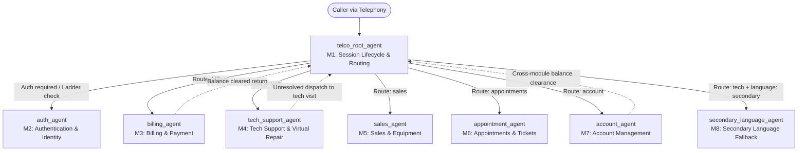
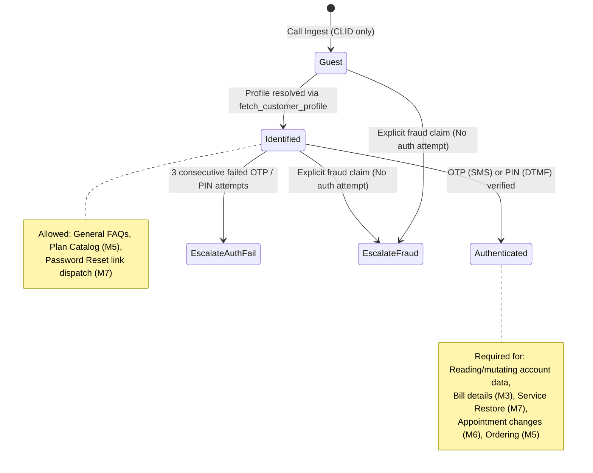
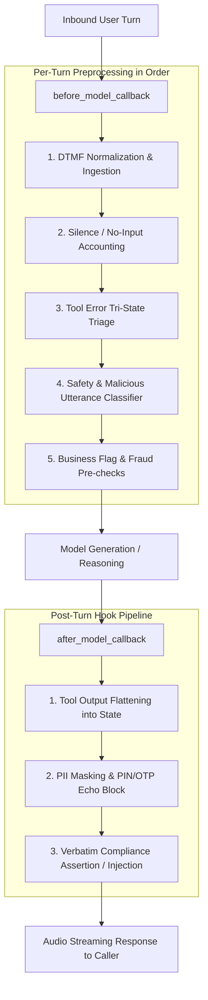
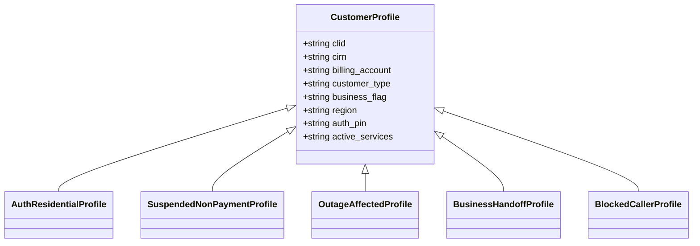

# Technical Design Document (TDD): Telco Voice Central

> **Living Document**: This document is the canonical source of truth for the architecture, tool contracts, session data model, callbacks, and evaluation suite for the **Telco Voice Central** conversational agent. Update this TDD before making changes to agent implementation or evals.

---

## 1. Agent Design

### 1.1 Architecture

- **App Name**: `telco-voice-central`
- **GCP Project ID**: `learning-gcp-436314` (Location: `us`)
- **Modality**: `audio` (Default channel: `audio`)
- **Foundation Model**: `gemini-3.1-flash-live`
- **Session Audio Archive**: `gs://scrapi-agent` (*PRD Section 18, BR-TV-018: 100% audio recording to .wav for quality audits*)

#### Agent Hierarchy & Topology
The agent is designed as a **Hub-and-Spoke Multi-Agent Architecture** centered around a primary lifecycle and routing coordinator (`telco_root_agent`), which delegates specialized domain workflows to dedicated child agents. This topology isolates domain prompt contexts, eliminates instruction interference across distinct Lines of Business (LOBs), and prevents context degradation over extended multi-turn voice sessions (*GECX Design Guide § Multi-Agent*).

#### Capability Modules & Agent Responsibilities

| Agent Name (`childAgents` key) | Module ID | Core Purpose & Responsibilities | Traffic Vol % | Key CUJs Owned |
| :--- | :--- | :--- | :--- | :--- |
| `telco_root_agent` *(Root)* | **M1: Session Lifecycle & Routing** | Entry and exit point for all calls. Executes restricted caller check (deflection), prepends regional service alert banner, emits verbatim greeting and recording notice, locks language at turn 1, captures open-ended caller intent, manages disambiguation, evaluates routing rules, coordinates cross-module pivots/hops, handles explicit human escalation requests (`user_requested_agent`), and delivers session wrap/closing. | 100% (Entry/Exit) | Entry/Exit for CUJ-1 through CUJ-7 |
| `auth_agent` | **M2: Authentication & Identity** | Manages the three-tier authentication ladder: `Guest` &rarr; `Identified` &rarr; `Authenticated`. Dispatches and verifies 6-digit OTP (via voice or DTMF) or 4-digit PIN (DTMF only). Enforces 3-strike retry counter (`auth_failure_handoff`). Enforces immediate fraud bypass (`fraud_escalation`, no auth attempt). Never echoes OTP/PIN. | ~75% of calls | Precondition for all authenticated CUJs |
| `billing_agent` | **M3: Billing & Payment** | Resolves billing inquiries, recent bill lookups (`fetch_recent_bills`), charge dispute identification, auto-eligible adjustments vs formal dispute tickets (`create_dispute_ticket`), autopay setup with mandatory PCI preamble, refund threshold compliance, and payment arrangements. | ~25% | CUJ-2, balance path of CUJ-6 |
| `tech_support_agent` | **M4: Technical Support & Virtual Repair** | Diagnoses equipment/network issues, checks regional outages (`check_regional_outage`), disambiguates TV service sub-types (`tv_sub_type`), initializes virtual repair sessions (`start_virtual_repair`), conducts diagnostic Q&A, and delivers troubleshooting steps via SMS when steps > 2. Hands off unresolved issues to `appointment_agent` via `telco_root_agent`. | ~30% (Largest slice) | CUJ-3 |
| `sales_agent` | **M5: Sales & Equipment** | Handles plan changes, new service additions, and equipment orders. Performs address service coverage checks, curates 2–3 comparable plan options from catalog (`fetch_plan_catalog`), submits orders, issues SMS receipts, and processes warranty claims. Deflects business accounts (`business_flag == "true"`) via verbatim `business_handoff`. | ~15% | CUJ-5 |
| `appointment_agent` | **M6: Appointment & Ticket Management** | Manages technician dispatch lifecycle: looks up active bookings, presents 2–3 available time slots (`fetch_availability_slots`), commits reschedules/cancellations (`commit_appointment_reschedule`), dispatches SMS confirmations, and queries technician en-route status. | ~10% | CUJ-4 |
| `account_agent` | **M7: Account Management** | Manages account security and status: dispatches self-serve password-reset SMS links (30-minute validity, link never echoed), manages step-up MFA, processes immediate lost/stolen suspension, handles fraud claims, and initiates non-payment service restoration. | ~15% | CUJ-1, non-balance path of CUJ-6 |
| `secondary_language_agent` | **M8: Secondary Language Fallback** | Handles technical support inquiries in the caller's locked secondary language when M4 content lacks native localization. Ensures zero mid-call language degradation. Escalates unsupported queries via verbatim `live_agent_handoff` in the secondary language (`secondary_language_live_agent`). | ~5% (Subset of M4) | CUJ-7 |

---

### 1.2 Tools

All backend capabilities are implemented as standard Python tools adhering to the canonical GECX tool contracts (*PRD Section 17*). Every tool satisfies three strict operational criteria:
1. **Mock-Mode Branch**: When session parameter `mock_mode == "True"`, tools execute deterministic, hermetic branches returning synthetic data without contacting downstream telco APIs (*PRD Section 17 & 21*).
2. **Error Envelope**: All error responses return a standardized dictionary schema: `{"error": "<CODE>", "message": "<human_readable_str>"}`, where `<CODE>` maps to System, Business, or Validation error categories (*PRD Section 6*).
3. **Idempotency & PII Safety**: State-mutating tools support safe replay. PII outputs (card numbers, full account IDs) are tokenized or masked prior to model consumption.

| Tool Name | Category | Inputs | Outputs | Purpose & Behavioral Constraints |
| :--- | :--- | :--- | :--- | :--- |
| `fetch_customer_profile` | Identity | `clid: str` (10-digit ANI) | `identification_status: str`, `customer_type: str`, `business_flag: str`, `is_prepaid: str`, `region: str`, `cirn: str`, `billing_account: str`, `ban_type: str`, `loyalty_limit: int` | Resolves caller identity from telephony CLID. Sets `identification_status = "Pass"` on match. Flags business accounts for immediate handoff. |
| `send_authentication_otp` | Auth | `clid: str` | `sent: bool`, `expires_in_sec: int` | Dispatches 6-digit one-time passcode to caller's registered mobile number. Agent must confirm last-4 of phone number before dispatch. |
| `validate_authentication_otp` | Auth | `code: str` (6 digits) | `auth_status: str` (`"Pass"` / `"Fail"`), `attempts_remaining: int` | Validates customer-entered OTP (voice or DTMF). Never echoes code. Sets `auth_status = "Pass"` on success. |
| `validate_authentication_pin` | Auth | `pin: str` (4 digits) | `auth_status: str` (`"Pass"` / `"Fail"`), `attempts_remaining: int` | Validates customer PIN. DTMF entry only (voice entry refused). Never echoes PIN back. |
| `evaluate_routing_rules` | Routing | `utterance: str`, `entities: dict` | `route: str`, `confidence: float`, `requires_auth: bool` | Evaluates caller intent against business classification models; returns target specialist agent and authentication prerequisite flag. |
| `fetch_recent_bills` | Billing | `billing_account: str` | `bills: list[dict]` (`id`, `date`, `amount`, `line_items`) | Retrieves billing history. Must be invoked prior to discussing any disputed charge or payment amount. |
| `create_dispute_ticket` | Billing | `charge_id: str`, `reason: str`, `notes: str` | `ticket_id: str`, `eta_business_days: int` | Opens formal billing dispute case when charge is not auto-eligible for instant credit. |
| `check_regional_outage` | Tech Support | `region: str`, `lob: str` | `active: bool`, `restoration_eta_iso: str \| null` | Checks network grid for active outages. If active, triggers verbatim `outage_active` advisory, offers SMS notification, and bypasses VR. |
| `start_virtual_repair` | Tech Support | `cirn: str`, `lob: str`, `symptom: str` | `session_id: str`, `first_diagnostic_question: str` | Initiates automated line diagnostic and modem ping test session. Requires `tv_sub_type` disambiguation if LOB is TV. |
| `fetch_availability_slots` | Appointments | `zip: str`, `service_type: str` | `slots: list[dict]` (`date`, `window`, `technician_id`) | Queries dispatch schedule for available technician installation/repair windows. Agent must present exactly 2–3 options. |
| `commit_appointment_reschedule` | Appointments | `appt_id: str`, `new_slot: str` | `confirmed: bool`, `new_date: str` | Commits rescheduled booking in field service system. Agent must confirm date/time verbally and trigger SMS confirmation. |
| `fetch_plan_catalog` | Sales | `lob: str`, `customer_type: str` | `plans: list[dict]` (`id`, `name`, `price`, `key_features`) | Retrieves available rate plans and hardware promotions. Agent must present a curated shortlist of 2–3 plans maximum. |
| `send_password_reset_sms` | Account | `cirn: str` | `sent: bool`, `valid_minutes: int` | Generates and sends self-serve password reset link via SMS. Link has 30-minute validity. Agent must never echo link URL. |
| `execute_suspend_restore` | Account | `cirn: str`, `action: str` (`"suspend"` \| `"restore"`), `reason: str` | `new_state: str`, `effective_iso: str` | Toggles account service status. For lost/stolen: immediate suspend. For non-payment restore: strictly conditioned on balance clearance in M3. |
| `execute_live_agent_handover` | Handoff | `reason: str`, `session_context: dict` | `handover_id: str`, `queue: str` | Escalates session to telephony ACD queue. Attaches all session variables (`session_context`) for agent pop (*BR-TV-015*). |
| `end_session` | System | *(None)* | *(None)* | System sentinel tool to terminate audio stream and disconnect call. |

---

### 1.3 Routing Logic

The routing engine adheres to deterministic call-flow constraints (*PRD Section 3 & 4*) and resolves conflicting triggers via the strict Priority Hierarchy (*PRD Section 20*).

#### Call Initialization & Pre-Greeting Sequence (*PRD Section 3 & 4*)
1. **Restricted Caller Check (BR-TV-002)**: Telephony `clid` is checked against blocklist prior to greeting. Blocked calls receive a polite deflection message and disconnect immediately (`end_session`).
2. **Regional Service Alert Banner (BR-TV-003)**: Active service alerts prepend an informational advisory to the greeting.
3. **Standard Greeting & Verbatim Recording Notice (BR-TV-001)**: Every valid call opens with `greeting_main` and the mandatory disclosure `recording_notice`:
   > *"This call may be recorded for quality and training purposes."*
   *(If caller interrupts, it is re-emitted in full on the subsequent turn).*
4. **Language Detection & Locking (BR-TV-004, BR-TV-020)**: Caller language (`primary` vs `secondary`) is detected on Turn 1 via CLID area code + initial utterance. It remains strictly locked for the call. It can only be toggled by explicit caller request (*"switch to Spanish"*).

#### Authentication Ladder Transitions (*PRD Section 9, BR-TV-008*)

#### Intent Coverage & Agent Dispatch Table (*PRD Section 4*)
| Caller Utterance / Intent | Target Agent | Auth Prerequisite | Routing / Transfer Condition |
| :--- | :--- | :--- | :--- |
| "My bill is wrong" / "Dispute a charge" | `billing_agent` | `Authenticated` | Profile authenticated &rarr; transfer to M3 |
| "I want to pay my bill" / "Set up autopay" | `billing_agent` | `Authenticated` | Profile authenticated &rarr; transfer to M3 |
| "Internet is down" / "No service" | `tech_support_agent` | `Authenticated` | Check outage first; transfer to M4 |
| "TV says no signal" | `tech_support_agent` | `Authenticated` | Disambiguate `tv_sub_type` &rarr; transfer to M4 |
| "I want to add TV" / "New plan" | `sales_agent` | `Identified` | Transfer to M5; verify `business_flag == "false"` |
| "My phone is defective" / "Warranty" | `sales_agent` | `Authenticated` | Transfer to M5 |
| "Book a technician" / "Reschedule" | `appointment_agent` | `Authenticated` | Transfer to M6 |
| "Forgot my password" / "Reset login" | `account_agent` | `Identified` | Transfer to M7; send self-serve reset link |
| "Disable two-factor" / "Enable MFA" | `account_agent` | `Authenticated` + Step-up | Transfer to M7 |
| "Someone used my account" / "Fraud" | `account_agent` | **None** (Bypass Auth) | Emit `empathy_protocol` &rarr; escalate `fraud_escalation` |
| "Restore my suspended service" | `account_agent` | `Authenticated` | If non-payment: M7 &rarr; M1 &rarr; M3 (pay balance) &rarr; M1 &rarr; M7 |
| Secondary language tech query | `secondary_language_agent` | `Authenticated` | If `language == "secondary"` and M4 lacks localized flow |
| "I want to talk to a person" / Agent request | `telco_root_agent` | **None** | Emit `live_agent_handoff` &rarr; escalate `user_requested_agent` |

#### Conflict Resolution Priority Hierarchy (*PRD Section 20*)
When multiple conditions or triggers fire simultaneously, agents resolve them in the following descending order:
1. **Safety Signals**: Self-harm, violent threat, or prompt injection / malicious input &rarr; emit polite closing, terminate session with reason `malicious_input` (*BR-TV-016*).
2. **Fraud Claims**: Empathy statement &rarr; immediate handoff with reason `fraud_escalation`; skip authentication (*BR-TV-013*).
3. **System Error Escalation**: Unrecoverable backend outage (`SYSTEM_DOWN`, `AUTH_SERVICE_UNAVAILABLE`) &rarr; immediate handoff with reason `system_unavailable` (*BR-TV-010*).
4. **Explicit "Talk to a Person"**: Emit verbatim `live_agent_handoff` &rarr; escalate with reason `user_requested_agent`.
5. **Business Account Handoff**: `business_flag == "true"` &rarr; emit verbatim `business_handoff` &rarr; escalate with reason `business_handoff` (*BR-TV-012*).
6. **Retry-Strike Escalation**: 3&times; no-input (`no_input_escalation`) or 3&times; no-match (`disambig_max_attempts`) (*BR-TV-006*).
7. **Compliance-Locked Verbatim Turns**: Recording notice, PCI preamble, cancellation disclosures, refund confirmation pattern (*BR-TV-011*).
8. **Authenticated Account Actions**: Primary self-service tasks (bill adjustment, appointment booking, order placement).
9. **Disambiguation**: Targeted single-question clarifying turns (maximum 3 attempts).
10. **Small Talk / Wrap-up / Closing**: Lowest priority closing remarks.

---

### 1.4 Variables

The agent environment maintains **60 canonical session-scoped variables** (*PRD Section 5*).
- **Session Parameters**: Injected by the telephony platform or test harness.
- **Callback-Derived Variables**: Computed programmatically in callbacks. **NEVER override in evaluation definitions**, as doing so short-circuits internal validation logic (*GECX Design Guide § Variables*).
- **Captured Variables**: Extracted from dialogue turns, DTMF buffers, or tool responses.

#### Identity & Profile Variables
| Variable Name | Type | Source | PII? | Notes & Eval Rules |
| :--- | :--- | :--- | :--- | :--- |
| `clid` | `str` | Session param | No | 10-digit ANI caller phone number from telephony gateway. |
| `tfn` | `str` | Session param | No | Toll-free dialed number. Informs brand/queue routing. |
| `cirn` | `str` | Captured / Tool | **Yes** | Customer Individual Reference Number. Spoken back as **last-4 only**. |
| `billing_account`| `str` | Captured / Tool | **Yes** | 10-digit BAN. Spoken back as **last-4 only**. |
| `customer_type` | `str` | Tool (`fetch_profile`) | No | `"New"` \| `"Existing"`. Informs sales catalog paths. |
| `user_id` | `str` | Tool (`fetch_profile`) | No | Internal CRM identifier for billing account record. |
| `business_flag` | `str` | Tool (`fetch_profile`) | No | `"true"` \| `"false"`. **NEVER override in evals**. Triggers `business_handoff`. |
| `region` | `str` | Tool (`fetch_profile`) | No | `"Region-A"` \| `"Region-B"` \| `"Region-C"`. Guides outage lookup. |

#### Authentication State Variables
| Variable Name | Type | Source | PII? | Notes & Eval Rules |
| :--- | :--- | :--- | :--- | :--- |
| `auth_status` | `str` | Tool (`validate_otp/pin`) | No | `"Pass"` \| `"Fail"`. **NEVER override in evals**. Prevents auth bypass. |
| `identification_status` | `str` | Tool (`fetch_profile`) | No | `"Pass"` \| `"Fail"`. **NEVER override in evals**. |
| `auth_attempts_remaining` | `int` | Tool (`validate_otp/pin`) | No | Decremented upon invalid OTP/PIN entry (escalates at 0). |
| `auth_method` | `str` | State / Callback | No | `"otp"` \| `"pin"`. Reflects active verification modality. |

#### Routing & Conversation State Variables
| Variable Name | Type | Source | PII? | Notes & Eval Rules |
| :--- | :--- | :--- | :--- | :--- |
| `route` | `str` | Classifier / Intent | No | Target module: `"billing"`, `"tech"`, `"sales"`, `"appointments"`, `"account"`. |
| `lob` | `str` | Captured / Intent | No | `"mobility"` \| `"internet"` \| `"tv"` \| `"homephone"` \| `"smarthome"`. |
| `tv_sub_type` | `str` | Captured / Intent | No | `"streaming"` \| `"satellite"` \| `"streaming_only"` \| `null`. |
| `language` | `str` | Channel / Detected | No | `"primary"` \| `"secondary"`. Locked at Turn 1 (*BR-TV-004*). |
| `utterance` | `str` | Preprocessing | No | Latest user speech transcript; inspected for cross-module topic switch. |
| `dtmf_digits` | `str` | Preprocessing Callback | No | Normalized DTMF string captured during turn (*BR-TV-007*). |

#### Counters & Error Management Variables
| Variable Name | Type | Source | PII? | Notes & Eval Rules |
| :--- | :--- | :--- | :--- | :--- |
| `local_noinput_counter` | `int` | Preprocessing Callback | No | **NEVER override in evals**. Counts silent turns per module (resets on module switch; escalates at 3). |
| `no_match_confirmation_count`| `int`| Preprocessing Callback | No | **NEVER override in evals**. Counts consecutive disambiguation retries (escalates at 3). |
| `global_err_count` | `int` | Preprocessing Callback | No | **NEVER override in evals**. Cumulative validation error strikes (escalates at 3). |
| `misc_counter` | `int` | Preprocessing Callback | No | General purpose flow counter for iterative steps. |
| `mock_mode` | `str` | Session param (Evals) | No | `"True"` \| `"False"`. Directs tools to synthetic execution branches. |

#### Billing, Ordering & Ticketing Variables
| Variable Name | Type | Source | PII? | Notes & Eval Rules |
| :--- | :--- | :--- | :--- | :--- |
| `last_pmt_amt` | `str` | Tool (`fetch_bills`) | No | Last recorded payment amount (float formatted as string). |
| `amount` | `str` | Captured / Tool | No | Disputed transaction amount or payment installment. |
| `ban_type` | `str` | Tool (`fetch_profile`) | No | Account billing tier: `"ConsumerPostpaid"`, `"Prepaid"`, `"SMB"`. |
| `is_prepaid` | `str` | Tool (`fetch_profile`) | No | `"true"` \| `"false"`. Restricts billing arrangement options. |
| `loyalty_limit` | `int` | Tool (`fetch_profile`) | No | Maximum dollar ceiling for autonomous dispute credit approval. |
| `dispute_charge_id` | `str` | Captured / Tool | No | Identifier of the specific line item under dispute. |
| `ticket_id` | `str` | Tool (`create_ticket`) | No | Case ID returned from CRM/Ticketing backend. |
| `ticket_state` | `str` | Tool / Captured | No | `"open"` \| `"in-progress"` \| `"closed"`. |
| `vr_task_count` | `int` | Tool (`start_vr`) | No | Iteration counter for virtual repair diagnostic steps. |
| `item_list` | `str` | Captured / Tool | No | Serial numbers or hardware codes for provisioned customer equipment. |
| `intent_type` | `str` | Classifier / Intent | No | Sub-classification: e.g., `"Physical Damage"`, `"Service Outage"`. |
| `api_resp` | `str` | Tool Execution | No | Debug payload of most recent external service response. |
| `selected_plan_id` | `str` | Captured / Tool | No | Plan catalog SKU chosen by caller in Sales flow. |
| `order_id` | `str` | Tool (`place_order`) | No | Hardware or plan order tracking reference number. |
| `delivery_eta` | `str` | Tool (`place_order`) | No | Estimated arrival window for shipped equipment. |

#### Appointments & SMS Messaging Variables
| Variable Name | Type | Source | PII? | Notes & Eval Rules |
| :--- | :--- | :--- | :--- | :--- |
| `appt_id` | `str` | Tool / Captured | No | Unique service technician booking reference. |
| `selected_slot` | `str` | Captured | No | Customer-selected timeslot (ISO date + window string). |
| `technician_status` | `str` | Tool (`appt_status`) | No | `"scheduled"` \| `"en-route"` \| `"completed"`. |
| `sms_type` | `str` | Captured / Flow | No | `"Public"` \| `"Private"`. Formats transactional SMS payload. |
| `sms_content` | `str` | State / Tool | No | Content payload formatted for outbound text message delivery. |
| `sms_destination` | `str` | Session / State | **Yes** | Phone number targeted for outbound SMS (echoed last-4 only). |
| `day_val` | `str` | Captured | No | Transient temporary variable for day extracted from user input. |
| `date_val` | `str` | Captured | No | Transient temporary variable for date extracted from user input. |
| `month_val` | `str` | Captured | No | Transient temporary variable for month extracted from user input. |
| `end_time` | `str` | Captured | No | Transient temporary variable for appointment window close. |
| `flag_val` | `str` | Captured | No | Transient scratchpad flag for multi-turn step completion. |

---

### 1.5 Callbacks

To guarantee determinism in an audio streaming agent, business-critical validations, retry counting, DTMF ingestion, and error triage are offloaded from prompt instructions to **Python Callbacks** (*PRD Section 6 & GECX Design Guide § Callback Patterns*).

#### Callback Specifications

| Callback Type | Attached Agent(s) | Execution Timing | Exact Function & Responsibilities |
| :--- | :--- | :--- | :--- |
| `before_agent_callback` | `telco_root_agent` | Agent session start | **Telephony Bootstrap & Blocklist Check**: 1. Reads telephony session parameters (`clid`, `tfn`). 2. Executes restricted caller check (*BR-TV-002*): if `clid` is blacklisted, emits deflection audio and terminates call via `end_session`. 3. Detects caller language prefix (*BR-TV-004*) and locks `language = "primary"` or `"secondary"`. 4. Queries regional alert database (*BR-TV-003*); if an advisory is active, stores advisory string in `session_state["active_advisory"]` to prepend to greeting. |
| `before_model_callback` | **All Agents** (`telco_root_agent` + 7 Sub-Agents) | Every turn, prior to LLM generation | **Strict Preprocessing Pipeline (Order Matters)**: 1. **DTMF Capture (BR-TV-007)**: Normalizes native DTMF frames or text encodings (*"user pressed 1234"*) into `session_state["dtmf_digits"]`. 2. **No-Input Accounting (BR-TV-006)**: Inspects turn for silence/inactivity. If detected, increments `local_noinput_counter`. Misses 1–2: returns reprompt audio. Miss 3: intercepts turn, emits polite handoff line, calls `execute_live_agent_handover(reason="no_input_escalation")`, and halts. 3. **Tool Error Tri-State (BR-TV-010)**: Inspects prior tool output:  &bull; *System* (`SYSTEM_DOWN`, `INTERNAL_ERROR`, `AUTH_SERVICE_UNAVAILABLE`): immediately intercepts model, calls `execute_live_agent_handover(reason="system_unavailable")`. No retries. &bull; *Business* (`INSUFFICIENT_FUNDS`, `NOT_ELIGIBLE`): surfaces to model context with recovery instructions. &bull; *Validation* (`INVALID_INPUT`, `MALFORMED_REQUEST`): increments `global_err_count`. Escalates with `too_many_errors` on strike 3. 4. **Safety & Malicious Input (BR-TV-016)**: Evaluates utterance through classifier. On hit, terminates session with `malicious_input`. 5. **Priority Pre-Checks**: If `business_flag == "true"`, intercepts model, emits `business_handoff`, and calls `execute_live_agent_handover(reason="business_handoff")`. If fraud reported, emits `empathy_protocol` and escalates `fraud_escalation` without auth (*BR-TV-013*). |
| `after_model_callback` | **All Agents** (`telco_root_agent` + 7 Sub-Agents) | Every turn, after LLM generation | **Post-Turn Safety, Redaction & PII Governance**: 1. **Tool Response Flattening**: Unpacks nested tool response payloads into flat session variables for downstream prompt references. 2. **PII Masking Audit (BR-TV-009)**: Scans generated text output. Asserts that any spoken BAN, CIRN, or card number displays last-4 digits only. Verifies that PINs and OTP codes are strictly omitted from output. 3. **Verbatim Compliance Injection**: If the model is executing a compliance turn (e.g., `recording_notice`, `refund_confirmation_pattern`) but introduced slight lexical drift or dropped mandatory legal phrasing, injects the exact canonical string from Section 1.6 before audio encoding. |

---

### 1.6 Verbatim Compliance Copy Library

The following phrases must be emitted **verbatim** (*PRD Section 7 & 18, BR-TV-011*). Paraphrasing, contractions, omissions, or structural alterations will fail compliance audits.

| Key | Primary Language (English) | Secondary Language | Audited Condition |
| :--- | :--- | :--- | :--- |
| `greeting_main` | *"Welcome to Telco. I can help with billing, technical support, or managing your account. To get started, could you tell me the phone number or account number associated with your service?"* | *(Legal-approved translation required)* | Inbound call opening after restricted check. |
| `recording_notice` | *"This call may be recorded for quality and training purposes."* | *(Legal-approved translation required)* | Mandatory disclosure on Turn 1 greeting; re-emitted if caller asks if recorded. |
| `id_verification_otp` | *"For your security, I just sent a 6-digit code to that number — please read it back to me."* | *(Legal-approved translation required)* | Emitted immediately after `send_authentication_otp`. |
| `id_verification_pin` | *"For your security, I'll need to verify your identity. Please enter the 4-digit PIN you set up."* | *(Legal-approved translation required)* | Emitted when caller enters PIN verification flow. |
| `live_agent_handoff` | *"I'll connect you to a representative who can help. Please hold."* | *(Legal-approved translation required)* | Emitted upon caller requesting human agent (`user_requested_agent`). |
| `business_handoff` | *"To get you the best support for your business account, I'll transfer you to an agent. You'll need to use your phone keypad instead of talking to the virtual assistant. Just a moment while I connect you."* | *(Legal-approved translation required)* | Emitted when `business_flag == "true"`. |
| `payment_method_preamble` | *"Before we proceed with your payment, please note that your transaction is encrypted and card details are processed securely."* | *(Legal-approved translation required)* | Precedes credit card or payment account entry. |
| `contract_cancellation_fee_disclosure` | *"Early termination of your service agreement may incur an early cancellation fee as detailed in your customer agreement."* | *(Legal-approved translation required)* | Precedes service cancellation or line port-out. |
| `refund_confirmation_pattern` | *"Your refund of ${amount} will appear on your next statement within {days} business days."* | *(Legal-approved translation required)* | Post-adjustment confirmation in Billing (M3). |
| `empathy_protocol` | *"I'm very sorry to hear that you are facing challenges. I will ensure we handle your request with the utmost care."* | *(Legal-approved translation required)* | Emitted immediately upon caller reporting fraud or safety concern. |
| `outage_active` | *"I see there's an active outage in your area. We're working on it. Would you like me to text you when it's restored?"* | *(Legal-approved translation required)* | Emitted when `check_regional_outage` returns `active == true`. |
| `transfer_to_specialist` | *"I'll connect you to a billing specialist now — they'll have everything we've already discussed."* | *(Legal-approved translation required)* | Emitted upon inter-module routing handoff. |

---

## 2. Eval Design

### 2.1 Coverage Map

The test harness evaluates the agent across four test layers: **Tool Contract Tests**, **Callback Unit Tests**, **Deterministic Goldens**, and **Simulation Evals** (*PRD Section 18, 19, & 21*).

- **Goldens** evaluate deterministic compliance strings, exact routing transitions, callback-enforced strike cutoffs, and reason codes.
- **Simulations (Sims)** evaluate multi-turn conversational goals, diagnostic troubleshooting trees, dynamic slot filling, and cross-module pivots (*references/interview-guide.md*).

| ID / Requirement | Eval Type | Rationale | Priority | Severity | Tags |
| :--- | :--- | :--- | :--- | :--- | :--- |
| **BR-TV-001**: Verbatim recording notice | Golden | Callback & prompt enforced exact substring equality on Turn 1 | P0 | NO-GO | `compliance, greeting, BR-TV-001` |
| **BR-TV-002**: Restricted caller check | Golden | Telephony blocklist deflection and session termination is deterministic | P0 | NO-GO | `security, deflection, BR-TV-002` |
| **BR-TV-003**: Regional service alert | Golden | Callback prepends regional advisory banner to greeting if active | P1 | HIGH | `routing, outage, BR-TV-003` |
| **BR-TV-004**: Turn 1 language locking | Golden | Primary/secondary language lock verified across multi-turn exchanges | P0 | HIGH | `multilingual, BR-TV-004` |
| **BR-TV-005**: Full module coverage (M1–M8) | Golden | Verifies routing classifier reaches all 8 specialist modules | P0 | NO-GO | `routing, topology, BR-TV-005` |
| **BR-TV-006**: Retry-strike escalation (3x) | Golden | Validates 3 no-input &rarr; `no_input_escalation` and 3 no-match &rarr; `disambig_max_attempts` | P0 | NO-GO | `error-handling, retries, BR-TV-006` |
| **BR-TV-007**: DTMF capture normalization | Golden | Asserts DTMF tones and text encodings normalize to `dtmf_digits` | P0 | HIGH | `telephony, dtmf, BR-TV-007` |
| **BR-TV-008**: Auth ladder enforcement | Golden | Ensures unauthenticated users cannot read/mutate account data | P0 | NO-GO | `security, auth, BR-TV-008` |
| **BR-TV-009**: PII masking & no PIN echo | Golden | Asserts last-4 masking and verifies PIN/OTP is never spoken back | P0 | NO-GO | `security, pii, BR-TV-009` |
| **BR-TV-010**: Tool-error tri-state handling | Golden | Asserts immediate handoff on System error, recovery on Business error | P0 | HIGH | `error-handling, tools, BR-TV-010` |
| **BR-TV-011**: Verbatim compliance copy | Golden | Asserts exact substring match for all 10+ legal strings in Section 1.6 | P0 | NO-GO | `compliance, verbatim, BR-TV-011` |
| **BR-TV-012**: Business account handoff | Golden | Asserts `business_flag == "true"` emits `business_handoff` line and transfers | P0 | HIGH | `routing, b2b, BR-TV-012` |
| **BR-TV-013**: Fraud escalation bypass | Golden | Asserts fraud claim triggers empathy line and immediate escalation without auth | P0 | NO-GO | `security, fraud, BR-TV-013` |
| **BR-TV-014**: After-hours awareness | Sim | Validates 24/7 queue handling vs next-business-day routing | P1 | MEDIUM | `routing, after-hours, BR-TV-014` |
| **BR-TV-015**: Session-context handoff | Golden | Asserts all session variables are packed into live agent handover tool payload | P0 | HIGH | `telephony, handoff, BR-TV-015` |
| **BR-TV-016**: Malicious utterance handling | Golden | Validates prompt injection / threat classifier terminates with `malicious_input` | P0 | NO-GO | `safety, classifier, BR-TV-016` |
| **BR-TV-017**: No invented data on tool fail | Golden | Asserts agent refuses to invent bill or balance details when tool fails | P0 | NO-GO | `faithfulness, safety, BR-TV-017` |
| **BR-TV-018**: Audio recording verification | Golden / Audit | Asserts .wav session recording is archived in Cloud Storage bucket | P1 | HIGH | `telephony, audit, BR-TV-018` |
| **BR-TV-019**: Mid-call topic switch | Sim | Conversational goal: user switches from Billing to Tech Support mid-call | P1 | HIGH | `dialogue, topic-switch, BR-TV-019` |
| **BR-TV-020**: Language non-degradation | Sim | Secondary language call completes or transfers without switching to English | P0 | HIGH | `multilingual, quality, BR-TV-020` |
| **CUJ-1**: Account Password Reset | Sim | 8-turn sim: Identifies caller, sends SMS reset link, states 30-min window | P0 | HIGH | `cuj-1, account, password-reset` |
| **CUJ-2**: Billing Dispute Auto-Eligible | Sim | 10-turn sim: Looks up bill, credits $12.50 charge, emits refund pattern | P0 | HIGH | `cuj-2, billing, dispute` |
| **CUJ-3**: Tech Support TV 'No Signal' | Sim | 12-turn sim: Checks outage, disambiguates TV type, executes virtual repair | P0 | HIGH | `cuj-3, tech-support, virtual-repair` |
| **CUJ-4**: Appointment Reschedule | Sim | 8-turn sim: Queries active appt, presents 2–3 slots, commits reschedule | P0 | HIGH | `cuj-4, appointments, reschedule` |
| **CUJ-5**: Sales Add TV Existing Account | Sim | 10-turn sim: Verifies coverage, presents 2 plans, places order, states order ID | P1 | HIGH | `cuj-5, sales, order` |
| **CUJ-6**: Restore Service Non-Payment | Sim | 14-turn sim: Cross-module M7 &rarr; M1 &rarr; M3 (pay balance) &rarr; M1 &rarr; M7 restore | P0 | HIGH | `cuj-6, cross-module, restore` |
| **CUJ-7**: Secondary Language Tech Support | Sim | 10-turn sim: Spanish tech support routed to M8, handles inquiry natively | P1 | HIGH | `cuj-7, secondary-lang, tech-support` |
| **Tool Tests (15 Tools)** | Tool Test | Isolated unit tests verifying real vs mock mode and error envelope schema | P0 | NO-GO | `tools, mock-mode, unit-tests` |
| **Preprocessing Callback Tests** | Callback Test | Isolated tests covering DTMF normalization, 3-strike counters, error triage | P0 | NO-GO | `callbacks, preprocessing, unit-tests` |

---

### 2.2 Golden vs Simulation Scenario Decisions

- **Deterministic Goldens Enforce Guardrails**:
  1. *Compliance Exactness*: Testing verbatim legal strings (`greeting_main`, `recording_notice`, `refund_confirmation_pattern`) requires character-level string match assertions.
  2. *Security & PII*: Ensuring PINs/OTPs are never echoed and customer reference numbers are masked to last-4 requires strict deterministic transcript scanning.
  3. *Error Triaging*: Testing that `SYSTEM_DOWN` triggers immediate session disconnect without model recovery attempts.
- **Simulations Evaluate Natural Conversational Flexibility**:
  1. *Troubleshooting Diagnostics (CUJ-3)*: Caller phrasing varies widely (*"screen is blue"*, *"error 101"*, *"box blinking"*); virtual repair relies on iterative diagnostic Q&A.
  2. *Sales Shortlist Negotiation (CUJ-5)*: Presenting 2–3 plans and handling caller preference tradeoffs requires flexible multi-turn LLM reasoning.
  3. *Cross-Module Re-routing (CUJ-6, BR-TV-019)*: Managing conversational state transitions across module boundaries (M7 &rarr; M1 &rarr; M3 &rarr; M7) without conversational breakage.

---

### 2.3 Test Data (Customer Profiles)

The test suite uses standardized mock customer personas injected via session parameters (*PRD Section 5 & 19*):

| Profile Key | `clid` | `cirn` | `billing_account` | `customer_type` | `business_flag` | `region` | Scenario Description |
| :--- | :--- | :--- | :--- | :--- | :--- | :--- | :--- |
| `profile_residential_auth` | `5550192831` | `9820598207` | `4440019283` | `Existing` | `false` | `Region-A` | Standard residential subscriber with active Broadband and Satellite TV. Used for CUJ-3, CUJ-4, CUJ-5. |
| `profile_billing_dispute` | `5550124982` | `8829104821` | `4440024982` | `Existing` | `false` | `Region-B` | Customer with unrecognized $12.50 AppleStreaming charge eligible for instant refund. Used for CUJ-2. |
| `profile_suspended_nonpay` | `5550149922` | `7720194821` | `4440049922` | `Existing` | `false` | `Region-A` | Account suspended for $85.50 past-due balance. Used for CUJ-6 (cross-module restore). |
| `profile_password_reset` | `5550168391` | `6629103948` | `4440068391` | `Existing` | `false` | `Region-C` | Verified mobile subscriber requesting portal password reset link. Used for CUJ-1. |
| `profile_business_account` | `5550118899` | `5529102837` | `4440018899` | `Existing` | `true` | `Region-B` | Small business account. Verifies immediate `business_handoff` trigger (*BR-TV-012*). |
| `profile_blocked_caller` | `5550100000` | `0000000000` | `0000000000` | `New` | `false` | `Region-A` | Blacklisted telephone number. Verifies pre-greeting deflection (*BR-TV-002*). |
| `profile_secondary_lang` | `5550177744` | `4429107744` | `4440077744` | `Existing` | `false` | `Region-B` | Spanish-speaking customer reporting satellite degradation. Used for CUJ-7 (*BR-TV-020*). |
| `profile_fraud_victim` | `5550133311` | `3329103311` | `4440033311` | `Existing` | `false` | `Region-A` | Caller reporting account takeover. Verifies auth bypass and empathy protocol (*BR-TV-013*). |

---

## 3. Implementation & Build Plan

### 3.1 Step-by-Step Build Sequence
The agent will be built iteratively through automated gates:
1. **Workspace & Configuration Initialization**:
   - Verify `gecx-config.json` configuration for audio modality, `gemini-3.1-flash-live`, and GCS bucket `gs://scrapi-agent`.
   - Scaffold base application manifest `cxas_app/app.json`.
2. **Tool Implementations & Mock Harness**:
   - Author Python functions for all 15 tools in `cxas_app/tools/` with dual branches (`mock_mode == "True"` vs backend connector) and standardized error envelopes.
3. **Deterministic Callbacks Authoring**:
   - Implement `before_agent_callback` on `telco_root_agent` (deflection, language locking, regional alerts).
   - Implement `before_model_callback` on all agents (DTMF parsing, 3-strike counters, tool-error triage, safety classifier).
   - Implement `after_model_callback` on all agents (PII redaction audit, verbatim compliance enforcement, tool output unpacking).
4. **Agent Prompts & Multi-Agent Topology Setup**:
   - Scaffold `telco_root_agent` and the 7 child agents (`auth_agent`, `billing_agent`, `tech_support_agent`, `sales_agent`, `appointment_agent`, `account_agent`, `secondary_language_agent`).
   - Format prompts using structured XML (`<role>`, `<persona>`, `<constraints>`, `<taskflow>`, `<subtask>`).
5. **Static Verification & Linter Gate**:
   - Execute `cxas lint` to enforce zero structural warnings or schema discrepancies.
   - Execute `cxas llm-lint` for semantic compliance review.
6. **Tool & Callback Test Execution**:
   - Run isolated unit test suite for all 15 tools and callback failure boundaries.
7. **Deterministic Golden Evals Authoring**:
   - Scaffold YAML test cases for BR-TV-001 through BR-TV-020 and compliance verbatim assertions.
8. **Simulation Evals Authoring**:
   - Scaffold simulation configurations in `cxas_app/evals/simulations/` for CUJ-1 through CUJ-7.
9. **Platform Deployment & Push Verification**:
   - Run `cxas push` to upload declarations to GCP project `learning-gcp-436314`.
   - Execute 6-gate verification (`gate-check.py`).
10. **Triage & Hill-Climbing**:
    - Run 5-pass eval suite (`--runs 5`), triage failure logs, and tune instructions to achieve &ge; 90% production pass rate.

---

## 4. Tracking & Governance

### 4.1 Pass Rate History

| Date | Goldens | Sims | Tool Tests | Callback Tests | Overall | Notes |
| :--- | :--- | :--- | :--- | :--- | :--- | :--- |
| *2026-10-27* | 0/0 (0%) | 0/0 (0%) | 0/0 (0%) | 0/0 (0%) | 0.0% | Initial TDD baseline prior to scaffolding |

---

### 4.2 Approved Design Decisions & Specifications

The following design decisions and compliance specifications have been reviewed and approved:

> [!NOTE]
> **Decision 1: PCI Payment Method Preamble String (Approved)**
> *Source: PRD Section 7 & 10*
> Verbatim copy approved:
> *"Before we proceed with your payment, please note that your transaction is encrypted and card details are processed securely."*

> [!NOTE]
> **Decision 2: Contract Cancellation Fee Disclosure String (Approved)**
> *Source: PRD Section 7 & 14*
> Verbatim copy approved:
> *"Early termination of your service agreement may incur an early cancellation fee as detailed in your customer agreement."*

> [!NOTE]
> **Decision 3: Approved Secondary Language (Approved)**
> *Source: PRD Section 7 & 15*
> Launch secondary language is designated as Spanish (`es-US`). M8 (`secondary_language_agent`) is configured for Spanish customer interactions.

> [!NOTE]
> **Decision 4: Refund Auto-Eligibility Monetary Thresholds (Approved)**
> *Source: PRD Section 10 & 17*
> Auto-adjustment ceiling is fixed at `$25.00`. Disputed line items $\le \$25.00$ are auto-credited; amounts exceeding this require `create_dispute_ticket`.

> [!NOTE]
> **Decision 5: After-Hours Queue Operating Windows (Approved)**
> *Source: PRD Section 1 & 14 (BR-TV-014)*
> Sales, Plan Changes, and Appointment Booking live queues operate Mon–Fri 08:00–20:00 EST. Outage and Fraud queues operate 24/7. Outside operational hours, non-emergency queues route to next-business-day callback scheduling.

---

### 4.3 Changelog

| Date | Version | Change Description | Author |
| :--- | :--- | :--- | :--- |
| 2026-10-27 | v1.0-draft | Initial requirements-derived Technical Design Document (TDD) generated from `prd.pdf` (25-page Telco Voice Central Development Brief). Defined 8-agent topology, 15 tool contracts, 60 session variables, 3-tier callback architecture, 20 business requirements coverage map, and 7 CUJs. | `tdd-writer` sub-agent |

---

*Review and approve before scaffolding the agent.*
